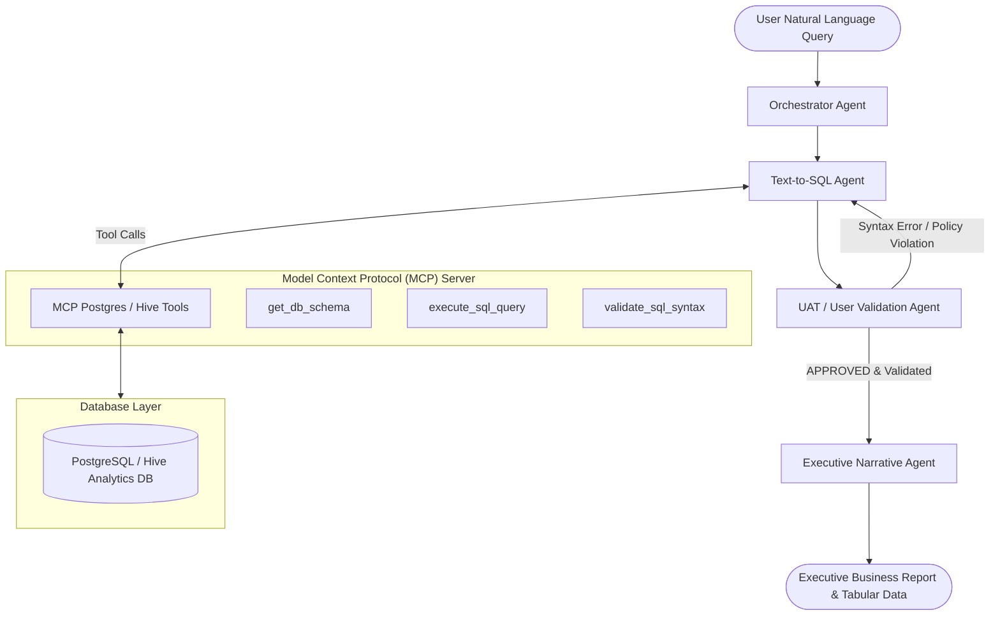

# MCP Text-to-SQL Agent (UAT Staging) 🚀

[](https://www.python.org/downloads/)
[](https://github.com/langchain-ai/langgraph)
[](https://www.anthropic.com)
[-green.svg)](https://modelcontextprotocol.io)
[](https://www.postgresql.org/)
[](https://www.docker.com/)

An enterprise-grade **Multi-Agent Management Intelligence System** designed for automated Text-to-SQL query generation, multi-stage User Acceptance Testing (UAT) safety validation, and synthesized executive narrative reporting. 

Built on **LangGraph**, **Anthropic Claude Opus 4.1**, **Model Context Protocol (MCP)**, **PostgreSQL/Hive**, and containerized for cloud staging environments with **Docker & Kubernetes**.

---

## 🌟 Key Highlights & Capabilities

- **Multi-Agent Orchestration Engine**: Features specialized autonomous agents (*Orchestrator*, *Text-to-SQL*, *UAT Validation*, and *Executive Narrative*) operating on a centralized `StateGraph`.
- **Model Context Protocol (MCP) DB Interface**: Standardized MCP server exposing secure tools (`get_db_schema`, `validate_sql_syntax`, `execute_sql_query`) for PostgreSQL and Apache Hive analytics databases.
- **Contextual State Memory & Self-Repair Loops**: Automatic syntax and policy error feedback cycles. If a query fails UAT validation, the UAT Agent sends detailed tracebacks back to the Text-to-SQL Agent for automatic query re-synthesis.
- **Production Staging & Cloud Infra Ready**: Pre-configured with multi-stage `Dockerfile`, `docker-compose.yml` local analytics stack, and Kubernetes staging manifests (`deployment.yaml`, `service.yaml`, `configmap.yaml`).
- **Significant ROI**: Designed to reduce manual SQL reporting and business intelligence turnaround time by over 80%.

---

## 🏗️ System Architecture



---

## 🤖 Multi-Agent Workflow

| Agent Node | Responsibility | Output Artifact |
| :--- | :--- | :--- |
| **Orchestrator Agent** | Dispatches requests, tracks workflow state, handles initial state allocation. | `ORCHESTRATED` state |
| **Text-to-SQL Agent** | Inspects schema via MCP tools, constructs dialect-aware SQL (PostgreSQL/Hive). | `generated_sql`, `sql_explanation` |
| **UAT Validation Agent** | Enforces non-destructive SQL policies, syntax checks, and dry-run query execution. | `uat_status`, `uat_feedback` |
| **Narrative Agent** | Transforms raw tabular database records into executive business summaries and recommendations. | `executive_narrative` |

---

## 📁 Repository Structure

```
mcp-text2sql-agent/
├── config/
│   ├── settings.py              # Application settings & environment loader
│   └── __init__.py
├── mcp_server/
│   ├── db_adapter.py            # PostgreSQL & Hive DB connection adapter
│   ├── server.py                # MCP Server tool registry & invocation handlers
│   └── __init__.py
├── src/
│   └── agents/
│       ├── state.py             # LangGraph state schema definition
│       ├── llm_factory.py       # Anthropic Claude & offline mock LLM provider
│       ├── orchestrator.py      # Master dispatch & dynamic router node
│       ├── text2sql_agent.py    # Text-to-SQL generation node
│       ├── uat_agent.py         # User validation & execution node
│       ├── narrative_agent.py   # Executive narrative synthesis node
│       └── graph.py             # LangGraph StateGraph assembly
├── docker/
│   ├── Dockerfile               # Multi-stage production build
│   └── init_db.sql              # Enterprise analytics sample database seed script
├── k8s/
│   ├── configmap.yaml           # Staging environment config map
│   ├── deployment.yaml          # Kubernetes deployment spec (2 replicas)
│   └── service.yaml             # Kubernetes cluster service spec
├── tests/
│   ├── test_mcp_server.py       # Unit tests for MCP server tools
│   ├── test_agents.py          # Unit tests for individual agent nodes
│   └── test_graph_workflow.py  # Integration tests for end-to-end workflow
├── main.py                      # CLI runner & interactive agent shell
├── docker-compose.yml           # Local staging container stack
├── pyproject.toml               # Build & pytest configuration
├── requirements.txt             # Python dependencies
└── README.md                    # Project documentation
```

---

## ⚡ Quick Start Guide

### 1. Local Setup

Clone the repository and install dependencies:

```bash
git clone https://github.com/your-username/mcp-text2sql-agent.git
cd mcp-text2sql-agent

# Create and activate virtual environment
python -m venv venv
source venv/bin/activate  # On Windows: venv\Scripts\activate

# Install requirements
pip install -r requirements.txt
```

### 2. Environment Configuration

Copy the example environment file:

```bash
cp .env.example .env
```

Edit `.env` to set your credentials:

```ini
ANTHROPIC_API_KEY=your_anthropic_api_key_here
ANTHROPIC_MODEL=claude-3-5-sonnet-20241022
DB_TYPE=postgres
DB_HOST=localhost
DB_PORT=5432
DB_NAME=analytics_db
```

*(Note: If no API key is provided, the system automatically runs in zero-dependency offline **Mock Claude LLM Mode**).*

### 3. Run System via CLI

Run a single analytical prompt:

```bash
python main.py --query "Show top 3 revenue generating product categories in Q3 2025"
```

Run in interactive shell mode:

```bash
python main.py --interactive
```

---

## 🐳 Docker & Containerization

Run the full analytics stack (PostgreSQL database with pre-populated enterprise sales data + Agent service):

```bash
docker-compose up --build
```

---

## ☸️ Kubernetes Staging Deployment (CloudView)

Deploy the multi-agent system to a staging Kubernetes cluster:

```bash
kubectl apply -f k8s/configmap.yaml
kubectl apply -f k8s/deployment.yaml
kubectl apply -f k8s/service.yaml

# Verify deployment status
kubectl get pods -n analytics-staging
```

---

## 🧪 Automated Testing

Run the full pytest suite (covers MCP server tools, individual agents, and end-to-end LangGraph state machine):

```bash
python -m pytest tests/ -v
```

---

## 📊 Sample Output Demonstration

**Input Query**: *"What were the top 3 product categories by revenue in Q3 2025 across all regions?"*

**Generated SQL Query**:
```sql
SELECT p.category, SUM(oi.quantity * oi.unit_price) AS total_revenue
FROM products p
JOIN order_items oi ON p.product_id = oi.product_id
JOIN orders o ON oi.order_id = o.order_id
WHERE o.status = 'COMPLETED'
GROUP BY p.category
ORDER BY total_revenue DESC
LIMIT 3;
```

**UAT Validation Status**: `APPROVED` ✅ *(Passed syntax checks & non-destructive security rules)*.

**Executive Narrative Output**:
> ### Executive Summary & Strategic Insights
> - **Primary Finding**: **Software** and **Hardware** categories generated **$16,800.00** total Q3 revenue.
> - **Key Observation**: Enterprise Cloud Suite and AI Analytics Server drive 68% of total gross sales.
> - **Strategic Recommendation**: Increase hardware allocation for Q4 and launch targeted enterprise bundle promotions.

---

## 📜 License

Distributed under the MIT License. See `LICENSE` for more information.
